<h3>aashvi@github ~ $ ./contributions.sh</h3>

  

<h3>aashvi@github ~ $ whoami</h3>

<table>
<tr>
<td valign="top" width="370"></td>
<td valign="top" width="490"></td>
</tr>
</table>

 

<h3>aashvi@github ~ $ ./links.sh</h3>

<a href="https://aashvigeddam.com">aashvigeddam.com</a> &nbsp;·&nbsp;
<a href="https://linkedin.com/in/aashvi-geddam">LinkedIn</a> &nbsp;·&nbsp;
<a href="mailto:aashvi.geddam@gmail.com">aashvi.geddam@gmail.com</a>

